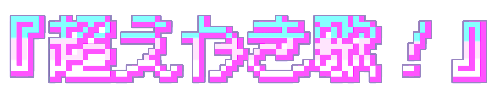

# 超えかき歌！

自分で描いた絵が、自分だけの絵描き歌になる。

超えかき歌！は、子どもが描いた絵からオリジナルの絵描き歌をつくるWebアプリです。絵と描き順をもとにAIが歌詞を作り、VOICEVOXで歌声にします。

目指しているのは、「また描いてみたい」と思える体験です。自分の絵が歌になり、家族や友達と一緒に楽しめます。

## [公開版で絵描き歌をつくる](https://cho-ekaki-uta.nitsc-proclub.workers.dev/)

インストールせずにブラウザから開けます。歌の生成にはインターネット接続が必要です。

## 描く → 歌をつくる → 再生する

### 1. 好きな絵を描く

マウスや指で、キャンバスに好きな絵を描いてください。完成画像だけでなく、描いた線の順序も記録します。

### 2. 「歌をつくる！」を押す

絵と描画情報から歌詞を生成し、歌唱用の楽譜と歌声を作ります。

### 3. 歌と一緒に絵を楽しむ

再生ボタンを押すと、歌詞に合わせて描画が進みます。保存した作品はあとから開いて楽しめます。

画像は操作マニュアルの画面例です。表示名や配置が現行版と異なる場合があります。クリックすると拡大できます。[画像の出典・加工](docs/assets/manual/README.md)／[詳しい操作ガイド](docs/guide/manual.md)

## 大切にしていること

### 描く楽しさを、もう一度

作品のコンセプトは「表現活動の肯定」です。絵を描き、できた歌を聴き、次の絵を描いてみる。主に4〜8歳の子どもが、自由な表現を楽しめる体験を目指しています。

### 絵描き歌らしい歌詞とメロディ

完成画像と描き順から歌詞を作り、独自の処理で音の高さや長さを決めます。再生時は、歌声に合わせた描画とカラオケ風の歌詞表示を楽しめます。

### 体験会の声を、使いやすさへ

2026年5〜9月に計6回の体験会を開き、延べ1,000人を超える子どもたちに使ってもらいました。操作する様子や保護者の反応をもとに、ボタンや案内を見直し、作品を持ち帰れる印刷機能を加えています。

[作品コンセプトと開発の背景](docs/guide/overview.md)で、体験会での改善と機能の仕組みを紹介しています。

## 操作と技術を詳しく知る

- [操作ガイド](docs/guide/manual.md)：描画から生成・再生まで
- [技術概要](docs/guide/technical-overview.md)：処理の流れ、採用技術、公開版とローカル展示版の違い
- [資料一覧](docs/README.md)：目的別の案内

作品の保存先は、公開版では同じブラウザ、ローカル展示版では展示用サーバーです。通常は1候補を生成し、新規のクラウド長期保存は停止中です。歌声が生成できない場合は、無音で描画を再生することがあります。

## 開発・展示運用

[開発環境の起動](docs/development/getting-started.md)／[展示・保守の案内](docs/operations/README.md)／[資料の置き方](docs/README.md#資料の管理方針)
