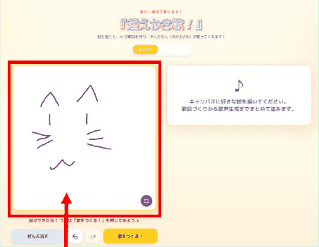
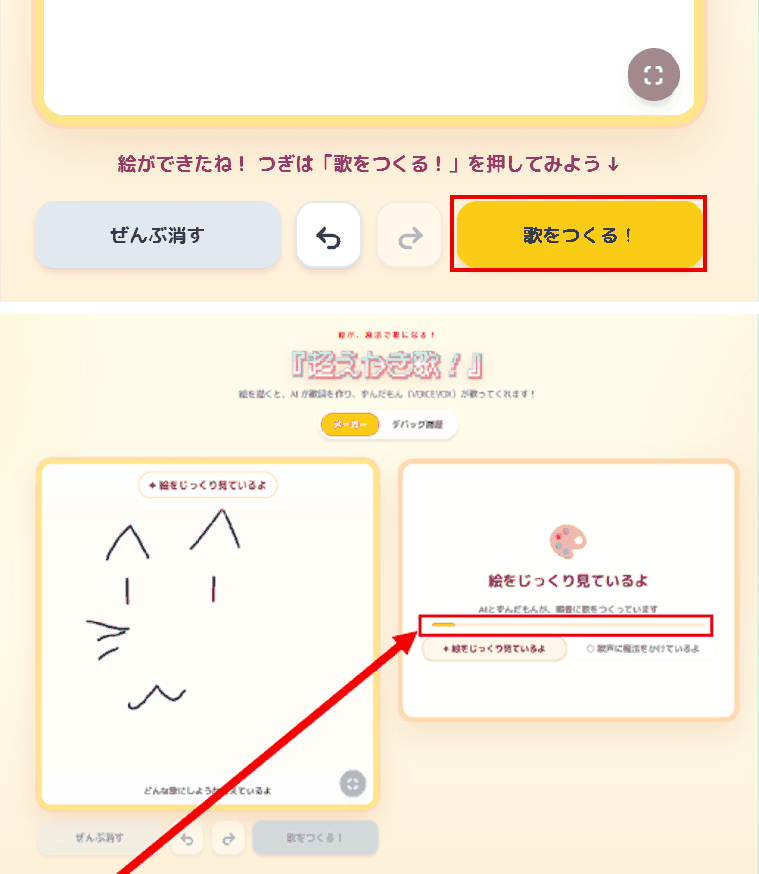
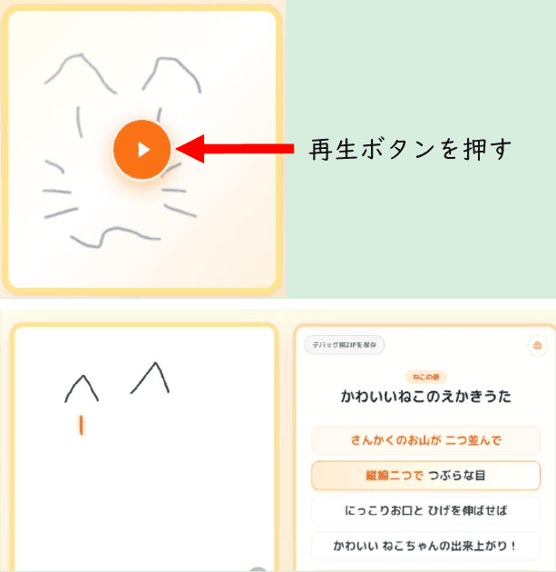

# 超えかき歌！

**自分で描いた絵が、自分だけの絵描き歌になる。**

ブラウザに描いた絵と描く順序をもとにAIが歌詞を作り、VOICEVOXで歌声にします。歌声に合わせて絵が描かれていく様子を、歌詞と一緒に楽しめます。

## [▶ 公開版を試す](https://cho-ekaki-uta.nitsc-proclub.workers.dev/)

インストールせずにブラウザから開けます。歌の生成にはインターネット接続が必要です。

## 描く → 歌をつくる → 再生する

### 1. 好きな絵を描く

マウスや指でキャンバスに描きます。完成画像だけでなく、描いた線の順序も記録します。

### 2. 「歌をつくる！」を押す

絵と描画情報から歌詞を生成し、歌唱用の楽譜と歌声を作ります。

### 3. 歌と一緒に絵を楽しむ

再生ボタンを押すと、歌詞に合わせて描画が進みます。保存した作品はあとから開いて楽しめます。

画像は提供された操作マニュアルの画面例です。現行版では表示名や配置が異なる場合があります。画像をクリックすると拡大できます。[画像の出典・加工](docs/assets/manual/README.md)／[詳しい操作ガイド](docs/guide/manual.md)

## 作品の特徴と実装の根拠

以下は審査に向けた説明観点です。公式の採点項目・配点を示すものではありません。

| 観点 | 伝えたい特徴・確認する体験 | 実装の入口 |
| --- | --- | --- |
| 独創性 | 完成した絵だけでなく描画の軌跡も使い、描く・歌う・見る体験をつなぐ。再生時の線と歌詞を確認 | [描画のグループ化](services/strokeGroupingService.ts)、[描画同期](components/DrawingPlaybackCanvas.tsx) |
| 技術性 | 歌唱用かなを音高・長さのある楽譜に変換し、VOICEVOXで合成。生成した歌声を確認 | [楽譜生成](services/melodyService.ts)、[歌声合成](services/voicevoxService.ts) |
| 実用性 | 保存した作品を再閲覧し、ギャラリーで楽しめる。保存した作品の画面から確認 | [ブラウザ保存](services/debugHistoryDb.ts)、[ギャラリー](gallery/useGalleryRecords.ts) |

[詳しい審査説明・デモ手順・実装対応表](docs/guide/judging-evidence.md)には、確認場所と関数名、公式資料の確認状況を記載しています。

## 操作と技術を詳しく知る

- [操作ガイド](docs/guide/manual.md)：描画から生成・再生まで
- [技術概要](docs/guide/technical-overview.md)：処理の流れ、採用技術、公開版とローカル展示版の違い
- [資料一覧](docs/README.md)：目的別の案内

公開版の作品は同じブラウザに保存されます。ローカル展示版は展示用サーバーの記録を使います。通常は1候補を生成し、新規のクラウド長期保存は停止中です。歌声が生成できない場合は、無音で描画を再生することがあります。

公開URL確認日：**2026-10-09（日本時間）**。HTTP 200とブラウザでの描画画面表示を確認しました。今回の資料整理では新規生成・音声合成・実音声再生は試していません。[確認範囲](docs/operations/verification-2026-10-09.md)

## 開発・展示運用

[開発環境の起動](docs/development/getting-started.md)／[展示・保守の案内](docs/operations/README.md)／[資料の置き方](docs/README.md#資料の管理方針)
